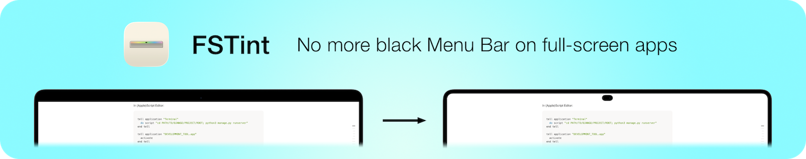

# FSTint

A lightweight macOS utility that colors the black Menu Bar area above a full-screen app on MacBook's built-in display.

It is designed to reduce the amount of time that the Menu Bar area on MacBook's built-in display remains completely black, where uneven pixel burn-in or image retention may be a concern, especially for MacBooks with OLED display.

Download the latest release from the [Releases page](https://github.com/homeofhx/fstint/releases/latest). FSTint supports Apple Silicon (ARM) Macs only running macOS 14.6 (Sonoma) or newer.

> [!NOTE]
> FSTint is a mitigation utility, not a guarantee against burn-in or image retention.

## Features

- Detects native full-screen apps in dedicated macOS Spaces.

- Responds when entering full screen, switching apps, or swiping between Spaces.

- Applies the tint only to the MacBook's built-in display's Menu Bar area.

- Temporarily hides the color tint when the mouse cursor reaches the Menu Bar.

- Runs as a menu bar app, and it supports launching automatically at login.

## How to Use

1. Click the FSTint icon in the Menu Bar.

	- You might need to grant FSTint Screen Recording permission.

2. Enter a native full-screen Space. FSTint will begin tinting automatically.

## How It Works

1. FSTint identifies the MacBook's built-in display.

2. It checks whether the foreground application has a window filling that display in a full-screen Space.

3. ScreenCaptureKit captures two logical rows of the full-screen app beginning two points below the built-in display's Menu Bar area.

4. FSTint selects a median color for every horizontal display column and builds a one-pixel-high color map.

5. A click-through AppKit panel stretches that map vertically across the Menu Bar area.

## Privacy

- Pixel sampling is performed locally and in memory.

- Capture is restricted to a thin strip belonging to the foreground full-screen application, and captured pixels are not written to disk.

- FSTint does not include networking or analytics code.

## Disclaimer & Limitation

- FSTint can't guarantee prevention of OLED burn-in or image retention.

- macOS may exclude protected content from screen capture.